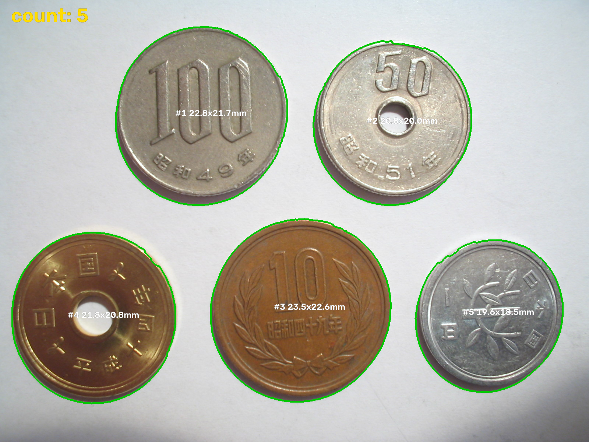
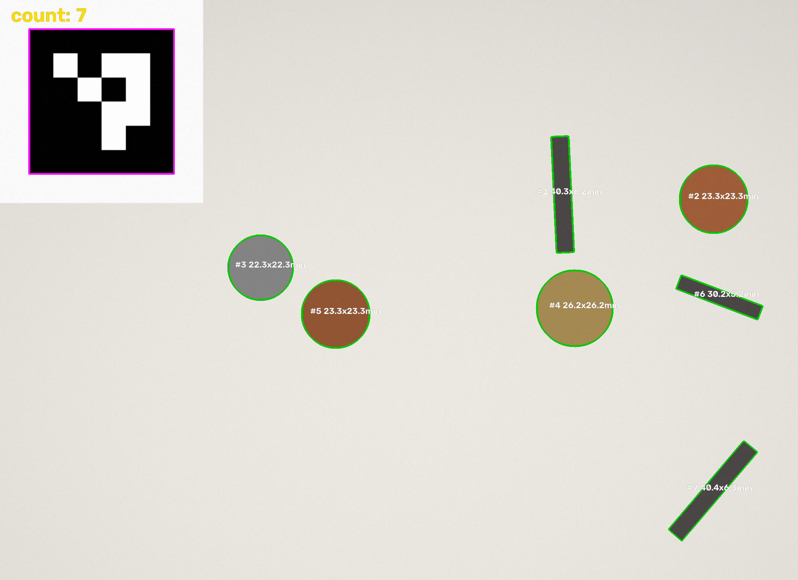

# count-and-measure

[](https://github.com/yousan514-hash/count-and-measure/actions/workflows/test.yml)

写真から**物を数えて、1つずつの大きさを mm で測る**ツールです（Python / OpenCV）。

物差しは2通りあります。

- **ArUco マーカー**（印刷した白黒の目印）を一緒に写す
- **大きさがわかっている物**（硬貨など）を物差しにする。印刷は要りません



> 本物の写真（白い紙の上の硬貨5枚）で、10円玉（23.5mm）を物差しにした結果。写真: Michiel1972 / [CC BY-SA 3.0](https://creativecommons.org/licenses/by-sa/3.0/)（[出典](https://commons.wikimedia.org/wiki/File:Japanese_Coins.jpg)、輪郭と文字を追加）

## できること

- 物の**数**を数える
- 1つずつの**長辺・短辺・円相当径・面積**を mm で出す
- 結果を書き込んだ画像と、**CSV**（Excel でそのまま開けます）を保存する
- 背景が明るい（紙）か暗い（布）かを自動で判定する
- フォルダを指定すると、中の画像をまとめて処理する

## 精度

### 本物の写真

上の写真（10円玉を物差し）:

| 硬貨 | 本当の直径 | 測った直径 | 差 |
|---|---|---|---|
| 100円 | 22.6 mm | 22.82 mm | +1.0% |
| 50円 | 21.0 mm | 20.75 mm | −1.2% |
| 5円 | 22.0 mm | 21.79 mm | −1.0% |
| 1円 | 20.0 mm | 19.60 mm | −2.0% |

もう1枚（硬貨6枚の切り抜き画像、500円玉を物差し）でも、6枚すべてを数え、直径の差は 2% 以内でした。

### 合成画像 10 枚

硬貨サイズの円と、ネジのような細長い物をプログラムで配置した画像（答えがわかっている）:

| 項目 | 結果 |
|---|---|
| 個数 | 10 枚すべてで正解と一致 |
| 1px あたりの長さ | 正解との差 1% 以内 |
| 長さ | 正解との差 5% 以内 |

`pixi run test` で、本物の写真と合成画像の両方を確認できます。



## 使い方

```powershell
# 初回のみ: pixi を入れて環境を作る
winget install prefix-dev.pixi
pixi install

# 1. 印刷用マーカーを作る → docs/marker_50mm_a4.png
pixi run marker
#    「実際のサイズ（100%）」で印刷し、黒い四角の1辺が 50mm か定規で確かめる

# 2. 物とマーカーを一緒に、真上から撮る

# 3. 測る（ファイルでもフォルダでも可）
pixi run measure photos/ --out results
#    マーカーの実測が 50mm でなければ: --marker-mm 49.5
```

マーカーを使わず、大きさがわかっている物を物差しにする場合:

```powershell
# 写っている中で一番大きい物（例: 10円玉 23.5mm）を物差しにする
pixi run measure coins.jpg --ref-mm 23.5

# 一番小さい物を物差しにする
pixi run measure parts.jpg --ref-mm 20.0 --ref smallest

# ぎりぎりで切り抜いた画像（物が画像の縁に触れている）
pixi run measure cropped.png --ref-mm 26.5 --keep-edge
```

出力（`results/`）:

| ファイル | 中身 |
|---|---|
| `○○_result.png` | 輪郭・番号・大きさを書き込んだ画像 |
| `○○.csv` | 番号、中心位置、長辺、短辺、円相当径、面積 |
| `summary.csv` | 画像ごとの個数 |

## 上手に撮るコツ

条件を1つずつ悪くした実験（[experiments/README.md](experiments/README.md)）で決めたルールです。

| ルール | 理由 |
|---|---|
| **真上から撮る**（硬貨を物差しにするとき） | 10度傾くだけで誤差が 9% になる。**マーカーを使えば、斜めでも自動で補正**する |
| **背景は白い紙か、明るい灰色にする** | 明るい灰色（銀色の硬貨とほぼ同じ明るさ）までは測れた。暗い灰色の机だと見分けられない |
| **暗すぎる場所で撮らない** | 明るさ 30% までは大丈夫、15% だと見つからない |
| **物同士は少し離す** | 少し触れる程度なら自動で分けるが、重なると1個になる |
| **影が濃く出る、横からの強い光は避ける** | 物が落とす影まで物として囲み、大きさが大きく出る |
| マーカーは**物と同じ高さ**に置く | 高さが違うと、物差しの長さがずれる |
| ぼけ・ノイズ・片側の影は気にしなくてよい | 強くても誤差 3% 以内 |

## 仕組み

1. 物差しを決める: ArUco マーカーの1辺、または大きさがわかっている物の長辺から「1ピクセル = 何 mm」を求める
2. 背景と物を分ける
   - 明るさで 2 値化（大津の方法）。マーカーの黒い部分で境目がずれないよう、先にマーカーを背景色で塗る
   - 光が当たった銀色の物は明るさだけでは背景と区別しにくいので、輪郭（Canny エッジ）から作った形で補う
   - 5円玉の穴や表面の模様のすき間を埋める
3. 輪郭ごとに、回転した外接長方形と面積から大きさを出す。画像の縁に触れた物は、写り切っていないとみなして除く（`--keep-edge` で残せる）

> 斜めから撮ると円が楕円になり、短辺が小さく出ます。硬貨のような丸い物は**長辺**が直径に近い値です。

## 今後やること

- [x] 本物の写真で試す（Wikimedia Commons の硬貨の写真 2 枚）
- [ ] 自分で撮った写真（マーカーあり）で試す
- [x] くっついた物を分けて数える（Watershed）
- [x] 斜めから撮った写真を補正する（マーカーで台形補正）
- [x] 照明のむら・暗い写真・強いノイズへの対策
- [x] 背景と物が近い明るさのときの確認（明るい灰色までは OK。明暗両方向で分ける方法は試したが悪化したので不採用）
- [x] 硬貨以外（ボルト・ナット・ワッシャー）で試す: 離れた物は数えられる。重なった物と、物が落とす影が課題（[experiments/README.md](experiments/README.md) の 4回目）
- [ ] 物が落とす影を見分けて外す
- [ ] 色や形で種類を分けて、種類ごとに数える

## 開発

```powershell
pixi run sample   # 合成画像を samples/ に作る
pixi run test     # テスト
```

環境: Windows 11 / Python 3.12 / OpenCV 5.0 / pixi

GitHub Actions で、push のたびに Windows と Linux でテストと撮影条件の実験を自動で動かしています（[.github/workflows/test.yml](.github/workflows/test.yml)）。

## ライセンス

コードは Apache-2.0。テスト用の写真は、それぞれのライセンスに従います（[ATTRIBUTION.md](ATTRIBUTION.md)）。
